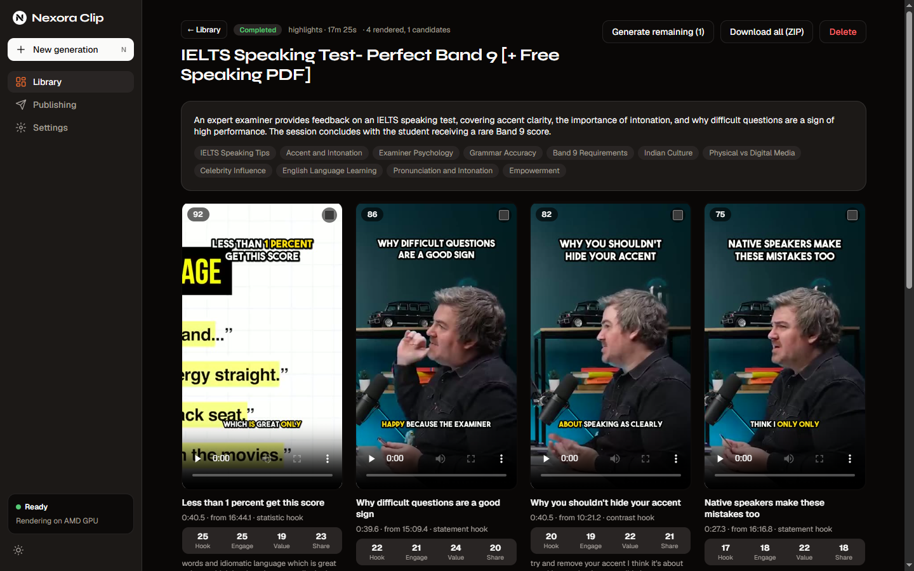
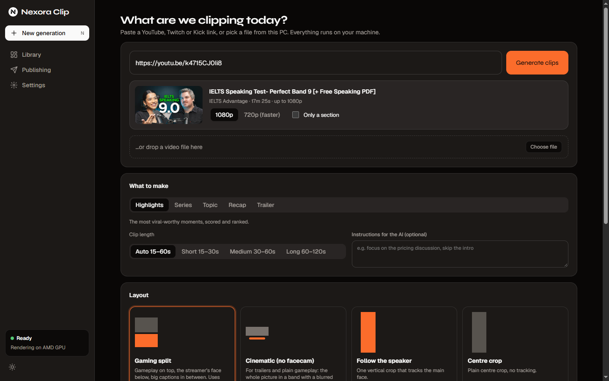
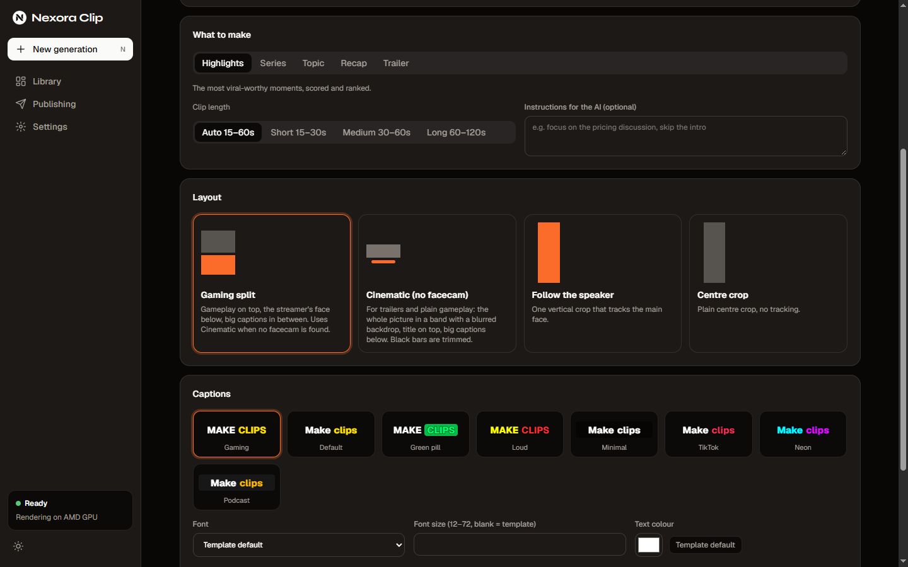
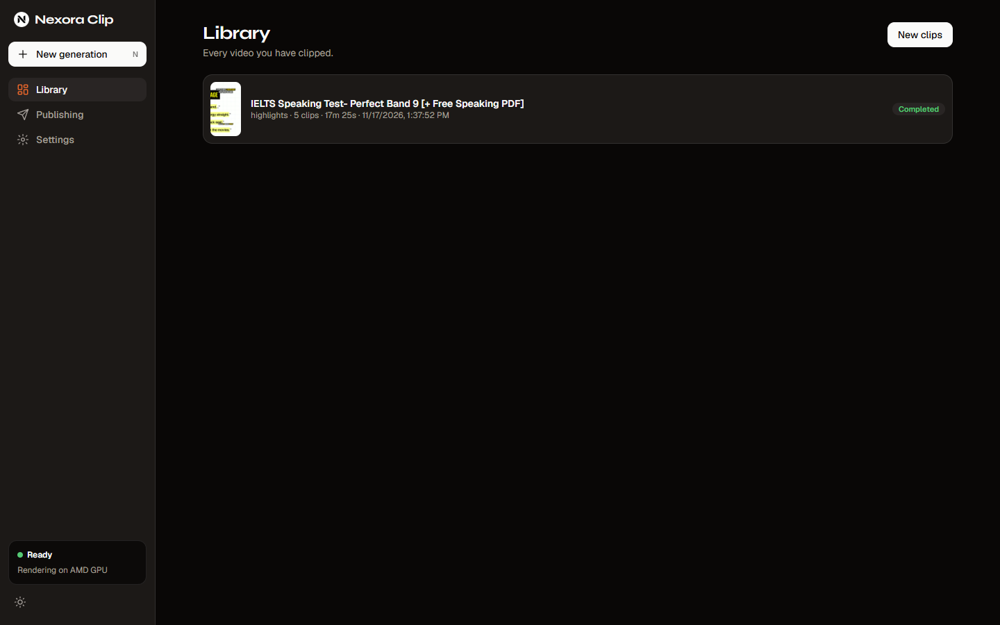
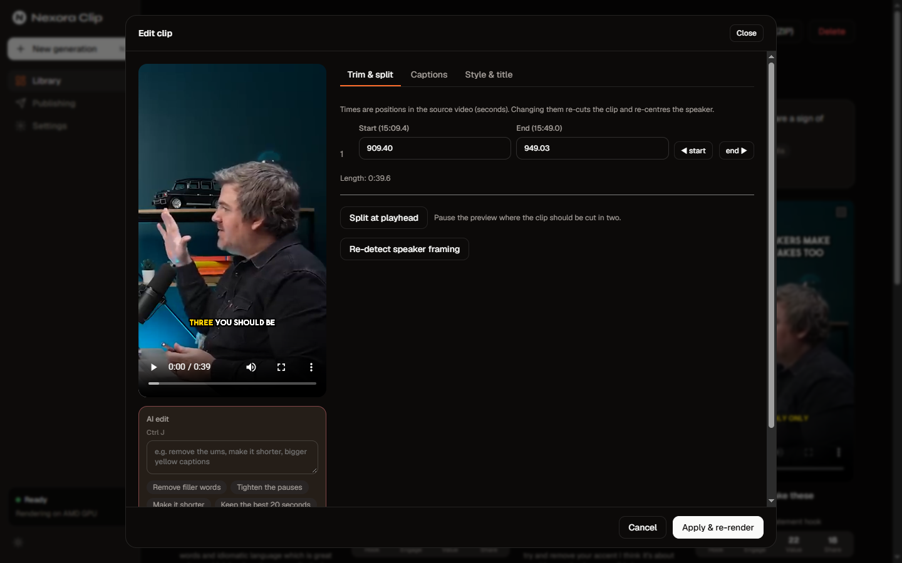
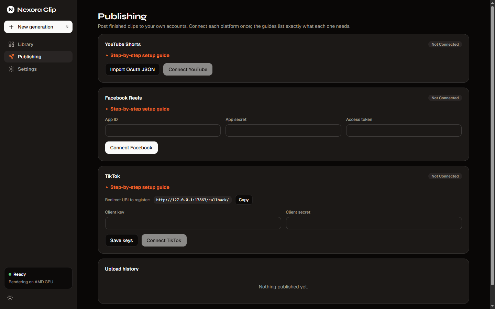
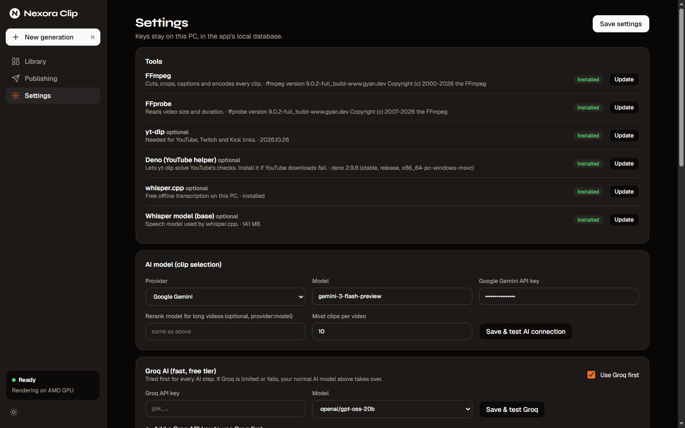

# Nexora Clip

**Turn long videos into vertical Shorts, Reels and TikToks, on your own PC.**

Paste a YouTube link or drop in a file. Nexora Clip finds the strongest moments, reframes them to 9:16 around the speaker, adds word-synced captions and a hook title, and renders finished clips. Native Windows app written in Rust: no Python, no Docker, no server.

[](https://github.com/nexoracteam/nexora-clip/releases/latest)


**[Download the installer](https://github.com/nexoracteam/nexora-clip/releases/latest)** · [Features](#features) · [Layouts](#layouts) · [Publishing](#publishing) · [Privacy](#what-leaves-your-pc) · [Build](#build-from-source)



## Screenshots

| | |
|---|---|
|  |  |
| **Paste a link.** The video card shows title, length and quality before you start. | **Pick a layout.** Gaming split, cinematic, follow the speaker, or centre crop. |
|  |  |
| **Library** of every video you have clipped. | **Clip editor** with trim, split, caption fixes and an AI edit box. |
|  |  |
| **Publishing** to YouTube Shorts, Facebook Reels and TikTok, with setup guides. | **Settings** for tools, AI models, rendering and storage. |

<sub>Sample clips in the screenshots are cut from "IELTS Speaking Test- Perfect Band 9" by IELTS Advantage (YouTube, licensed CC BY).</sub>

## Features

**Sources.** YouTube, Twitch and Kick links (through yt-dlp), or any local video. The downloader updates itself once if YouTube changes something and a download fails.

**Transcription.** The video's own subtitles when it has good ones (fast and free), otherwise local whisper.cpp (offline), AssemblyAI, Groq Whisper or OpenAI Whisper.

**Picking moments.** Free ways first: Gemini (free tier), Groq, OpenRouter's free models and Ollama on your PC. If one is busy or out of quota, the next free one answers by itself, and with no AI at all clips are still made, picked by sound and speech. Paid providers (OpenAI, Claude) keep working if you already use them. Long videos are read in overlapping 12-minute windows, then ranked together. Workflows: highlights, series (Part 1..N), topic, recap and trailer, plus free-text instructions. Every clip gets a score for hook, engagement, value and shareability.

**Game knowledge.** For GTA VI videos the AI knows the characters, places and release facts, speech recognition is told the names (Lucia, Leonida, Vice City…), and captions get their spelling and capitals right. Add your own notes from Settings. Hindi and Urdu captions can be shown in Roman letters.

**Videos with little speech.** With a Google key, Gemini watches a small 360p copy to choose moments, writes hooks from frames of the clip, and finds subtitles burned into the picture so they can be cropped off. Without it, moments are picked from scene changes and loudness.

**Rendering.** One ffmpeg pass per clip. A face-tracking crop (YuNet face detection, run in Rust), animated word-synced captions in 8 templates and 22 fonts (your own fonts too), an AI hook title, optional Pexels B-roll, loudness normalisation, and an optional branded outro. NVIDIA, Intel and AMD encoders are detected and used automatically. A 30 fps option renders about twice as fast.

**Render the best first.** Render only the best 3, 5 or 8 clips now. The rest stay as ranked candidates and are generated with one click.

**Editor.** Trim, split, merge, fix or hide caption words, change style and title, or describe a change in plain words ("remove the ums, make the captions bigger"). Every edit re-renders from the source, so nothing is compressed twice.

**Publish kit.** AI-written title, description and hashtags for YouTube Shorts, TikTok and Facebook Reels, plus a cover image, in one ZIP.

**Export.** Save a clip, export with a TikTok, Reels or Shorts preset, or download everything as a ZIP.

**Reliability.** Keys and tokens are encrypted with Windows DPAPI. Problems (missing tools or keys, low disk space) are caught before a long job starts. A crashed job is marked failed and can be resumed. One window at a time, the window size is remembered, and there is a log file under Settings.

## Layouts

- **Gaming split.** Gameplay on top, the streamer's face below (found automatically), big captions in between, hook title on top. A face that fills the frame is treated as a talking head and followed instead.
- **Cinematic (no facecam).** For trailers and plain gameplay: the picture in a band over a blurred backdrop, black bars trimmed, title on top, captions below.
- **Follow the speaker.** One vertical crop that tracks the main face.
- **Centre crop.** A plain centre crop.

## Publishing

Post finished clips to your own accounts, using your own API apps:

- **YouTube Shorts**: Google OAuth with PKCE and resumable upload.
- **Facebook Reels**: Page access through the Graph API.
- **TikTok**: OAuth and direct post.

The Publishing page has a step-by-step guide for each platform, listing exactly what you need to create and where to paste it.

## What leaves your PC

Everything is cut and rendered locally. Text goes to the AI provider you choose (the transcript, to pick moments). If you switch on **Let Gemini look at the picture**, a few frames, or a small copy of videos with little speech, go to Google with your key; you can turn that off in Settings. Clips leave only when you publish them.

## Install

1. Download `Nexora-Clip_<version>_x64-setup.exe` from the [latest release](https://github.com/nexoracteam/nexora-clip/releases/latest) and run it. It installs for the current user and needs no admin rights.
2. Open **Settings**. Under **Tools**, press *Install everything missing*. FFmpeg is used from PATH when it exists; yt-dlp, Deno, whisper.cpp and the speech model are downloaded into the app's data folder.
3. Under **AI model**, pick a provider, paste its API key and press *Save & test AI connection*.

Windows may show a SmartScreen notice because the installer is not code-signed: choose *More info*, then *Run anyway*.

Your data lives in `%LOCALAPPDATA%\com.nexora.clip`.

## Build from source

Requires Rust (MSVC toolchain) and Node.js.

```bash
npm install
npx tauri build      # installer in src-tauri/target/release/bundle/nsis/
cargo test           # in src-tauri: 61 unit tests
```

For development: `npx tauri dev`.

## Project layout

| Path | Purpose |
|---|---|
| `src-tauri/src/pipeline.rs` | Task pipeline: download, transcribe, analyse, render |
| `src-tauri/src/ai.rs`, `llm.rs`, `gemini.rs`, `vision.rs` | Moment selection, workflows, model providers, picture-based features |
| `src-tauri/src/transcribe.rs`, `subs.rs` | Transcription and the video's own subtitles |
| `src-tauri/src/render.rs`, `face.rs`, `captions.rs` | ffmpeg render, face framing, captions |
| `src-tauri/src/editor.rs`, `kit.rs` | Trim, split, merge, exports, publish kit |
| `src-tauri/src/publish.rs` | YouTube, Facebook and TikTok publishing |
| `src-tauri/src/tools.rs`, `download.rs` | Tool installer, yt-dlp |
| `src-tauri/src/state.rs`, `secret.rs` | SQLite store, DPAPI encryption |
| `ui/` | The interface (plain HTML, CSS and JavaScript) |
